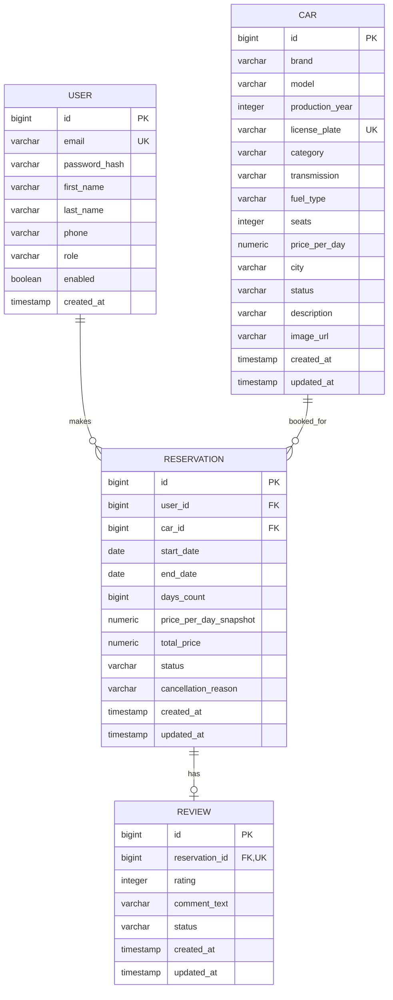

# Техническое задание: AutoRent KZ

**Версия:** 1.1 (MVP + frontend)  
**Дата:** 21.10.2026  
**Тип проекта:** итоговый учебный проект, монорепо платформы аренды автомобилей  
**Статус:** реализовано: backend + React frontend

---

## 1. Общие сведения

**AutoRent KZ** — платформа для поиска, бронирования и аренды автомобилей. MVP представляет собой REST API с документацией Swagger UI, ролевой моделью, JWT-аутентификацией и полным CRUD для трёх основных сущностей: автомобиль, бронирование, отзыв. Пользователи также являются полноценной сущностью и связаны с бронированиями.

Проект создаётся как итоговая работа по Java-разработке и должен продемонстрировать:

- Java 17/21 и Spring Boot;
- JPA/Hibernate и реляционную базу данных;
- не менее трёх связанных таблиц и CRUD для трёх ресурсов;
- Spring Security и две роли;
- Bean Validation и глобальную обработку ошибок;
- минимум два design pattern;
- JUnit 5, Mockito и интеграционные тесты;
- Git/GitHub, README и демонстрацию;
- бонусы: Docker, deploy, CI/CD.

### 1.1. Цель MVP

Дать работающий backend, который можно запустить, показать на демо и проверить через Swagger UI или Postman:

1. Зарегистрироваться или войти.
2. Посмотреть каталог автомобилей.
3. Найти свободный автомобиль на даты.
4. Создать бронирование и получить рассчитанную стоимость.
5. Убедиться, что повторное бронирование тех же дат возвращает `409 Conflict`.
6. Отменить бронирование.
7. Администратору — управлять автомобилями, бронированиями и отзывами.
8. Оставить отзыв после завершённой аренды.

### 1.2. Границы MVP

**Входит в MVP:**

- backend REST API;
- React frontend (SPA: каталог, бронирование, отзывы, админ-панель);
- Swagger UI / OpenAPI;
- H2 для локального запуска и тестов;
- PostgreSQL для профиля `postgres`;
- Flyway-миграция для PostgreSQL;
- JWT-аутентификация;
- роли `USER` и `ADMIN`;
- CRUD автомобилей, бронирований и отзывов;
- демонстрационные данные;
- unit- и integration-тесты;
- Dockerfile и `docker-compose.yml`;
- README и Postman-коллекция.

**Не входит в MVP (следующий этап):**

- онлайн-оплата и эквайринг;
- SMS/email-уведомления;
- загрузка фотографий в S3;
- refresh-token и blacklist токенов;
- сложная система скидок и промокодов;
- страхование и франшиза;
- deploy/CD (CI workflow добавлен, см. раздел 10.1).

### 1.3. Архитектура монорепо

Репозиторий разбит на две части:

- `backend/` — Spring Boot REST API;
- `frontend/` — SPA на React 19 + Vite, собранная статика встраивается в backend-jar (`static`), так что одно приложение отдаёт и сайт, и API. В dev-режиме Vite dev-server на `:5173` проксирует API-запросы на `:8080`.

---

## 2. Пользователи и роли

### 2.1. Роли

| Роль | Назначение |
|---|---|
| `USER` | Клиент платформы: ищет автомобили, бронирует, отменяет свои брони, оставляет отзывы |
| `ADMIN` | Администратор: управляет автопарком, всеми бронированиями и модерацией отзывов |

### 2.2. Матрица прав

| Действие | Гость | USER | ADMIN |
|---|---:|---:|---:|
| Регистрация / вход | ✅ | ✅ | ✅ |
| Просмотр каталога автомобилей | ✅ | ✅ | ✅ |
| Просмотр доступности на даты | ✅ | ✅ | ✅ |
| Просмотр отзывов автомобиля | ✅ | ✅ | ✅ |
| Просмотр своего профиля | ❌ | ✅ | ✅ |
| Редактирование своего профиля | ❌ | ✅ | ✅ |
| Создание бронирования | ❌ | ✅ | ✅ |
| Просмотр своих бронирований | ❌ | ✅ | ✅ |
| Просмотр чужого бронирования | ❌ | ❌ | ✅ |
| Отмена своего бронирования до начала аренды | ❌ | ✅ | ✅ |
| Отмена любого активного бронирования | ❌ | ❌ | ✅ |
| Создание отзыва по завершённой аренде | ❌ | ✅ | ✅ |
| Редактирование своего отзыва | ❌ | ✅ | ✅ |
| Удаление своего отзыва | ❌ | ✅ | ✅ |
| Удаление любого отзыва | ❌ | ❌ | ✅ |
| Создание / редактирование автомобиля | ❌ | ❌ | ✅ |
| Изменение статуса автомобиля | ❌ | ❌ | ✅ |
| Удаление автомобиля | ❌ | ❌ | ✅ |
| Просмотр всех бронирований | ❌ | ❌ | ✅ |
| Изменение дат бронирования | ❌ | ❌ | ✅ |
| Изменение статуса бронирования | ❌ | ❌ | ✅ |
| Удаление отменённого бронирования | ❌ | ❌ | ✅ |
| Модерация отзывов (скрыть/показать) | ❌ | ❌ | ✅ |

---

## 3. Функциональные требования

### FR-01. Регистрация и аутентификация

- `POST /api/v1/auth/register` создаёт пользователя с ролью `USER`.
- Пароль хранится только в виде BCrypt-хэша.
- Email уникален, приводится к нижнему регистру.
- `POST /api/v1/auth/login` проверяет учётные данные и возвращает JWT.
- JWT передаётся в заголовке `Authorization: Bearer <token>`.
- Время жизни токена задаётся переменной `JWT_EXPIRATION_SECONDS`, по умолчанию 24 часа.
- Публичные endpoints: регистрация, вход, просмотр каталога и отзывов, Swagger UI.

**Критерии приёмки:**

- повторная регистрация с тем же email → `409 Conflict`;
- неверный пароль → `401 Unauthorized`;
- запрос к защищённому endpoint без токена → `401`;
- запрос с ролью `USER` к административному endpoint → `403`.

### FR-02. Профиль пользователя

- `GET /api/v1/users/me` возвращает текущего пользователя.
- `PUT /api/v1/users/me` обновляет имя, фамилию и телефон.
- Email и роль через этот endpoint не меняются.
- Пароль и `passwordHash` никогда не попадают в ответ API.

### FR-03. Каталог автомобилей

- `GET /api/v1/cars` — публичный список.
- Фильтры: `brand`, `city`, `category`, `maxPrice`.
- Пагинация: `page`, `size` (максимум 50), `sortBy`, `direction`.
- `GET /api/v1/cars/{id}` — карточка автомобиля.
- В карточке отображается средний рейтинг и количество видимых отзывов.
- В публичном списке показываются только автомобили со статусом `ACTIVE`.
- `GET /api/v1/cars/available?startDate=...&endDate=...` возвращает только свободные на даты автомобили.

### FR-04. Проверка доступности

- Доступность рассчитывается по пересечению интервалов, а не по статическому полю.
- Бронирования в статусах `PENDING` и `CONFIRMED` блокируют даты.
- `CANCELLED` и `COMPLETED` не блокируют даты.
- Пересечение: `existing.startDate < new.endDate && existing.endDate > new.startDate`.
- При создании бронирования автомобиль блокируется на уровне БД (`PESSIMISTIC_WRITE`), чтобы два параллельных запроса не создали двойную бронь.

### FR-05. Создание бронирования

- `POST /api/v1/reservations` доступен аутентифицированному пользователю.
- Обязательные поля: `carId`, `startDate`, `endDate`.
- Даты: `startDate >= сегодня`, `endDate > startDate`, срок от 1 до 30 дней.
- Автомобиль должен быть `ACTIVE`.
- При пересечении дат → `409 Conflict`.
- Цена фиксируется в момент бронирования: `pricePerDaySnapshot`, `daysCount`, `totalPrice`.
- Бронирование создаётся в статусе `PENDING`.
- Скидка 10% применяется при сроке от 7 дней.

### FR-06. Мои бронирования

- `GET /api/v1/reservations/my` — список бронирований текущего пользователя.
- `GET /api/v1/reservations/{id}` — детали; USER видит только своё, ADMIN — любое.
- `PATCH /api/v1/reservations/{id}/cancel` — отмена.
- USER может отменить только `PENDING` или `CONFIRMED` до даты начала аренды.
- ADMIN может отменить активное бронирование.
- Причина отмены необязательна и сохраняется в `cancellationReason`.

### FR-07. Администрирование бронирований

- `GET /api/v1/reservations` — все бронирования с пагинацией.
- `PUT /api/v1/reservations/{id}` — изменение дат (только `PENDING`/`CONFIRMED`).
- `PATCH /api/v1/reservations/{id}/status` — смена статуса.
- `DELETE /api/v1/reservations/{id}` — удаление только `CANCELLED` и только если нет отзыва.
- При изменении дат проверяется доступность автомобиля и пересчитывается цена.

**Разрешённые переходы статусов:**

```
PENDING  -> CONFIRMED | CANCELLED
CONFIRMED -> COMPLETED | CANCELLED
COMPLETED, CANCELLED -> только терминальные состояния
```

- `COMPLETED` разрешён только после наступления `endDate`.
- Повторная установка того же статуса идемпотентна.

### FR-08. Отзывы

- `POST /api/v1/reviews` — создать отзыв.
- Отзыв можно оставить только по своему бронированию в статусе `COMPLETED`.
- Одно бронирование — один отзыв.
- Оценка: целое число от 1 до 5.
- Комментарий: от 3 до 1000 символов.
- `GET /api/v1/cars/{carId}/reviews` — публичные видимые отзывы.
- `GET /api/v1/reviews/{id}` — отзыв; скрытый отзыв видят только владелец и ADMIN.
- `PUT /api/v1/reviews/{id}` — редактирование владельцем (или ADMIN).
- `DELETE /api/v1/reviews/{id}` — удаление владельцем или ADMIN.
- `GET /api/v1/reviews` — все отзывы для ADMIN.
- `PATCH /api/v1/reviews/{id}/visibility` — скрыть/показать отзыв (ADMIN).

### FR-09. Управление автомобилями

- `POST /api/v1/cars` — создать автомобиль (ADMIN).
- `PUT /api/v1/cars/{id}` — обновить данные (ADMIN).
- `PATCH /api/v1/cars/{id}/status` — изменить статус (ADMIN).
- `DELETE /api/v1/cars/{id}` — удалить (ADMIN).
- Статусы: `ACTIVE`, `MAINTENANCE`, `ARCHIVED`.
- Только `ACTIVE` доступен для бронирования.
- Нельзя перевести автомобиль в `MAINTENANCE`/`ARCHIVED`, если у него есть активные бронирования.
- Если у автомобиля есть история бронирований, DELETE выполняет мягкое удаление (`ARCHIVED`), иначе — физическое.

### FR-10. Валидация и ошибки

- Все входные DTO валидируются Bean Validation.
- Для диапазона дат используется кастомная аннотация `@ValidDateRange`.
- Глобальный `@RestControllerAdvice` возвращает единый JSON ошибки.
- Обрабатываются: `400`, `401`, `403`, `404`, `405`, `409`, `500`.
- Ошибки валидации содержат карту `fieldErrors`.

### FR-11. Документация API

- Swagger UI: `/swagger-ui.html`.
- OpenAPI JSON: `/v3/api-docs`.
- Настроена схема `bearerAuth` (JWT).
- Все контроллеры и DTO имеют читаемые схемы.

### FR-12. Демонстрационные данные

При первом запуске на пустой БД создаются:

- администратор `admin@autorrent.kz` / `Admin123!`;
- пользователь `user@autorrent.kz` / `User123!`;
- 6 автомобилей;
- завершённое бронирование с отзывом;
- подтверждённое будущее бронирование для демонстрации конфликта дат.

Seed можно отключить: `APP_SEED_ENABLED=false` или `app.seed.enabled=false`.

---

## 4. Бизнес-правила

### 4.1. Даты и стоимость

- `startDate` — дата получения автомобиля.
- `endDate` — дата возврата.
- Количество дней: `ChronoUnit.DAYS.between(startDate, endDate)`.
- Пример: `2026-11-10` → `2026-11-14` = 4 дня.
- Максимальный срок: 30 дней.
- Цена: `pricePerDay * days`.
- При сроке ≥ 7 дней применяется скидка 10%.
- Итоговая цена округляется до 2 знаков (`HALF_UP`).
- Валюта: тенге (KZT).
- Бизнес-часовой пояс для трактовки дат: `Asia/Almaty` (в MVP даты хранятся как `LocalDate`).

### 4.2. Статусы бронирования

| Статус | Значение | Блокирует даты |
|---|---|---:|
| `PENDING` | Создано, ожидает подтверждения | ✅ |
| `CONFIRMED` | Подтверждено администратором | ✅ |
| `CANCELLED` | Отменено | ❌ |
| `COMPLETED` | Аренда завершена | ❌ |

### 4.3. Статусы автомобиля

| Статус | Значение | Можно бронировать |
|---|---|---:|
| `ACTIVE` | Доступен | ✅ |
| `MAINTENANCE` | На обслуживании | ❌ |
| `ARCHIVED` | В архиве / мягко удалён | ❌ |

### 4.4. Отзывы

- Отзыв привязан к завершённому бронированию, а не напрямую к автомобилю.
- Автомобиль и пользователь отзыва определяются через бронирование.
- Это исключает отзывы без факта аренды.
- Скрытые отзывы не попадают в публичный список и не учитываются в рейтинге.

### 4.5. Конкурентность

- Создание и изменение бронирования выполняется в транзакции.
- Перед проверкой пересечения дат автомобиль читается с `PESSIMISTIC_WRITE`.
- Это сериализует конкурирующие бронирования одного автомобиля.
- На уровне БД предусмотрены индексы по `car_id, start_date, end_date`.

---

## 5. Модель данных

### 5.1. ER-диаграмма



### 5.2. Связи

- `USER 1 → N RESERVATION` — пользователь делает много бронирований.
- `CAR 1 → N RESERVATION` — автомобиль имеет много бронирований.
- `RESERVATION 1 → 0..1 REVIEW` — у завершённого бронирования может быть один отзыв.
- Всего 4 таблицы, 3 связи; требование «минимум 3 связанные таблицы» выполнено.

### 5.3. Ограничения

- `users.email` — `UNIQUE`, `NOT NULL`.
- `cars.license_plate` — `UNIQUE`, `NOT NULL`.
- `reviews.reservation_id` — `UNIQUE`, `NOT NULL`.
- `reservations.end_date > reservations.start_date`.
- `reservations.days_count > 0`.
- `reservations.total_price >= 0`.
- `reviews.rating BETWEEN 1 AND 5`.
- `cars.seats BETWEEN 2 AND 9`.
- `cars.production_year BETWEEN 1990 AND 2100`.

### 5.4. Индексы

- `idx_reservations_car_dates (car_id, start_date, end_date)` — проверка доступности.
- `idx_reservations_user (user_id)` — «мои бронирования».
- `idx_reservations_status (status)` — фильтрация и отчёты.
- Уникальные индексы создаются ограничениями `UNIQUE`.

---

## 6. API

Базовый путь: `/api/v1`.  
Формат: JSON.  
Авторизация: `Authorization: Bearer <JWT>`.

### 6.1. Аутентификация

| Метод | Путь | Доступ | Описание |
|---|---|---|---|
| POST | `/auth/register` | публично | Регистрация |
| POST | `/auth/login` | публично | Вход, выдача JWT |

**Пример регистрации:**

```json
{
  "email": "client@example.kz",
  "password": "Client123!",
  "firstName": "Алия",
  "lastName": "Серикова",
  "phone": "+77011234567"
}
```

**Ответ:**

```json
{
  "token": "eyJhbGciOiJIUzI1NiJ9...",
  "tokenType": "Bearer",
  "expiresIn": 86400,
  "user": {
    "id": 3,
    "email": "client@example.kz",
    "firstName": "Алия",
    "lastName": "Серикова",
    "phone": "+77011234567",
    "role": "USER"
  }
}
```

### 6.2. Профиль

| Метод | Путь | Доступ | Описание |
|---|---|---|---|
| GET | `/users/me` | USER, ADMIN | Текущий профиль |
| PUT | `/users/me` | USER, ADMIN | Обновить имя, фамилию, телефон |

### 6.3. Автомобили

| Метод | Путь | Доступ | Описание |
|---|---|---|---|
| GET | `/cars` | публично | Каталог с фильтрами |
| GET | `/cars/available` | публично | Свободные на даты |
| GET | `/cars/{id}` | публично | Карточка |
| POST | `/cars` | ADMIN | Создать |
| PUT | `/cars/{id}` | ADMIN | Обновить |
| PATCH | `/cars/{id}/status` | ADMIN | Статус |
| DELETE | `/cars/{id}` | ADMIN | Удалить / архивировать |

**Параметры каталога:** `brand`, `city`, `category`, `maxPrice`, `page`, `size`, `sortBy`, `direction`.

**Параметры доступности:** `startDate` (ISO), `endDate` (ISO), остальные фильтры.

**Пример создания автомобиля:**

```json
{
  "brand": "Toyota",
  "model": "Camry",
  "year": 2023,
  "licensePlate": "123ABC01",
  "category": "COMFORT",
  "transmission": "AUTOMATIC",
  "fuelType": "PETROL",
  "seats": 5,
  "pricePerDay": 25000.00,
  "city": "Almaty",
  "description": "Комфортный седан",
  "imageUrl": "https://placehold.co/600x400?text=Toyota+Camry"
}
```

### 6.4. Бронирования

| Метод | Путь | Доступ | Описание |
|---|---|---|---|
| POST | `/reservations` | USER, ADMIN | Создать бронь |
| GET | `/reservations/my` | USER, ADMIN | Мои брони |
| GET | `/reservations/{id}` | владелец, ADMIN | Детали |
| PATCH | `/reservations/{id}/cancel` | владелец, ADMIN | Отменить |
| GET | `/reservations` | ADMIN | Все брони |
| PUT | `/reservations/{id}` | ADMIN | Изменить даты |
| PATCH | `/reservations/{id}/status` | ADMIN | Изменить статус |
| DELETE | `/reservations/{id}` | ADMIN | Удалить отменённую |

**Пример создания:**

```json
{
  "carId": 1,
  "startDate": "2026-11-10",
  "endDate": "2026-11-14"
}
```

**Ответ:**

```json
{
  "id": 15,
  "userId": 3,
  "userEmail": "client@example.kz",
  "carId": 1,
  "carBrand": "Toyota",
  "carModel": "Camry",
  "carLicensePlate": "123ABC01",
  "city": "Almaty",
  "startDate": "2026-11-10",
  "endDate": "2026-11-14",
  "daysCount": 4,
  "pricePerDay": 25000.00,
  "totalPrice": 100000.00,
  "status": "PENDING",
  "createdAt": "2026-10-20T12:00:00"
}
```

### 6.5. Отзывы

| Метод | Путь | Доступ | Описание |
|---|---|---|---|
| GET | `/cars/{carId}/reviews` | публично | Видимые отзывы авто |
| GET | `/reviews/{id}` | публично / владелец / ADMIN | Отзыв |
| POST | `/reviews` | USER, ADMIN | Создать |
| PUT | `/reviews/{id}` | владелец, ADMIN | Обновить |
| DELETE | `/reviews/{id}` | владелец, ADMIN | Удалить |
| GET | `/reviews` | ADMIN | Все отзывы |
| PATCH | `/reviews/{id}/visibility` | ADMIN | Скрыть/показать |

**Пример создания:**

```json
{
  "reservationId": 12,
  "rating": 5,
  "comment": "Көлік таза, қызмет жақсы."
}
```

### 6.6. Пагинация

Все списочные endpoints возвращают:

```json
{
  "content": [],
  "page": 0,
  "size": 10,
  "totalElements": 0,
  "totalPages": 0,
  "last": true
}
```

### 6.7. Ошибки

Единый формат:

```json
{
  "timestamp": "2026-10-20T12:00:00",
  "status": 409,
  "error": "Conflict",
  "message": "Car is not available for the selected dates",
  "path": "/api/v1/reservations",
  "fieldErrors": null
}
```

Ошибка валидации:

```json
{
  "timestamp": "2026-10-20T12:00:00",
  "status": 400,
  "error": "Bad Request",
  "message": "Validation failed",
  "path": "/api/v1/reservations",
  "fieldErrors": {
    "startDate": "must be a date in the present or in the future",
    "_global": "endDate must be after startDate and rental period must be between 1 and 30 days"
  }
}
```

---

## 7. Валидация и обработка ошибок

### 7.1. Bean Validation

| Поле / объект | Правила |
|---|---|
| `RegisterRequest.email` | `@NotBlank`, `@Email`, `@Size(max=255)` |
| `RegisterRequest.password` | `@NotBlank`, `@Size(min=8, max=72)` |
| `RegisterRequest.phone` | `@Pattern` (10–15 цифр, опционально `+`) |
| `CarRequest.brand`, `model` | `@NotBlank`, `@Size(max=50)` |
| `CarRequest.year` | `@Min(1990)`, `@Max(2100)` |
| `CarRequest.pricePerDay` | `@DecimalMin(0.01)`, `@Digits(8,2)` |
| `CarRequest.seats` | `@Min(2)`, `@Max(9)` |
| `ReservationRequest.carId` | `@NotNull` |
| `ReservationRequest.startDate` | `@NotNull`, `@FutureOrPresent` |
| `ReservationRequest.endDate` | `@NotNull`, `@Future` |
| `ReservationRequest` (класс) | `@ValidDateRange` |
| `ReviewRequest.rating` | `@Min(1)`, `@Max(5)` |
| `ReviewRequest.comment` | `@NotBlank`, `@Size(min=3, max=1000)` |

### 7.2. Кастомная валидация дат

`@ValidDateRange` проверяет:

- `endDate` строго больше `startDate`;
- срок не более 30 дней;
- null-значения пропускаются, чтобы работали стандартные `@NotNull`/`@Future`.

### 7.3. Global Exception Handler

| Исключение | HTTP |
|---|---|
| `MethodArgumentNotValidException` | 400 |
| `ConstraintViolationException` | 400 |
| `HttpMessageNotReadableException` | 400 |
| `MethodArgumentTypeMismatchException` | 400 |
| `MissingServletRequestParameterException` | 400 |
| `NotFoundException` | 404 |
| `ConflictException` | 409 |
| `DataIntegrityViolationException` | 409 |
| `AuthenticationException` | 401 |
| `AccessDeniedException` | 403 |
| `HttpRequestMethodNotSupportedException` | 405 |
| `Exception` | 500 |

Непредвиденные ошибки логируются, наружу отдаётся безопасное сообщение без stack trace и SQL.

---

## 8. Безопасность

- Spring Security 6, stateless-сессии.
- JWT HS256, библиотека JJWT 0.12.6.
- Пароли — BCrypt.
- Роли: `ROLE_USER`, `ROLE_ADMIN`.
- Публичные URL: `/api/v1/auth/**`, `GET /api/v1/cars/**`, `GET /api/v1/reviews/**`, Swagger, H2 console (в dev).
- Остальные запросы требуют аутентификации.
- Административные методы дополнительно защищены `@PreAuthorize("hasRole('ADMIN')")`.
- Проверка владельца выполняется в сервисном слое, чтобы USER не мог читать/менять чужие брони и отзывы.
- CORS настроен для локальной разработки; в production список origins нужно сузить.
- JWT-секрет и параметры БД задаются через переменные окружения.
- CSRF отключён, так как API stateless и не использует cookie-сессии.
- 401/403 возвращаются в JSON.

**Переменные окружения:**

| Переменная | Назначение | Значение по умолчанию |
|---|---|---|
| `JWT_SECRET` | Секрет HS256, минимум 32 байта | dev-секрет |
| `JWT_EXPIRATION_SECONDS` | Время жизни токена | `86400` |
| `DB_URL` | JDBC URL PostgreSQL | `jdbc:postgresql://localhost:5432/autorrent` |
| `DB_USER` | Пользователь БД | `autorrent` |
| `DB_PASSWORD` | Пароль БД | `autorrent` |
| `APP_SEED_ENABLED` | Демо-данные | `true` |

---

## 9. Архитектура и design patterns

### 9.1. Слои

```
Controller (REST, DTO, HTTP-коды)
        ↓
Service / Facade (бизнес-правила, транзакции)
        ↓
Repository (Spring Data JPA)
        ↓
Entity (JPA/Hibernate)
        ↓
PostgreSQL / H2
```

- Контроллеры не содержат бизнес-логики.
- Сервисы не зависят от HTTP.
- DTO отделены от entities; пароли и служебные поля не утекают.
- Транзакции — на сервисном слое.
- `open-in-view: false`.

### 9.2. Реализованные паттерны

| Паттерн | Где | Зачем |
|---|---|---|
| **Strategy** | `PricingStrategy`, `StandardPricingStrategy`, `LongTermDiscountPricingStrategy`, `PricingStrategyResolver` | Разные правила расчёта цены без `if/else` в сервисе |
| **Factory** | `ReservationFactory` | Централизованное создание бронирования с корректными полями и статусом |
| **Facade** | `BookingFacade` | Одна точка входа для сценария бронирования: пользователь, блокировка авто, проверка дат, цена, создание |
| **State (enum-based)** | `ReservationStatus`, `CarStatus` + проверка переходов | Явные допустимые переходы статусов |
| **Repository** | Spring Data JPA repositories | Абстракция доступа к данным |
| **DTO / Mapper** | records + `DtoMapper` | Отделение API-контракта от модели БД |
| **Dependency Injection** | Spring | Слабая связанность и тестируемость |

### 9.3. Структура пакетов

```
kz.autorrent
├── config          # Security, OpenAPI, DataInitializer
├── controller      # REST endpoints, PageRequestFactory
├── dto             # request/response records
├── entity          # JPA entities and enums
├── exception       # domain exceptions, GlobalExceptionHandler
├── mapper          # DtoMapper
├── repository      # Spring Data repositories
├── security        # JWT, UserDetails
├── service         # business logic, BookingFacade, Factory, rules
│   └── pricing     # Strategy implementations
└── validation      # @ValidDateRange
```

### 9.4. Транзакции и блокировки

- `BookingFacade.bookCar` — `@Transactional`.
- `CarRepository.findByIdForUpdate` — `@Lock(PESSIMISTIC_WRITE)`.
- Проверка пересечения и вставка бронирования происходят в одной транзакции.
- Ошибки бизнес-правил выбрасываются как `ConflictException`/`BadRequestException` и откатывают транзакцию.

---

## 10. Технологический стек

### 10.1. Основной стек

| Слой / задача | Технология | Версия | Обоснование |
|---|---|---|---|
| Язык | Java | 21 LTS | Требование методички (17/21), современный LTS, records, switch expressions |
| Framework | Spring Boot | 3.4.5 | Быстрый старт, автоконфигурация, экосистема |
| Сборка | Maven | 3.9.9 | Стандарт для Spring Boot, простой `pom.xml` |
| Web | Spring Web MVC | 6.2.x | REST API, JSON, валидация |
| ORM | Spring Data JPA + Hibernate | 6.6.x | Репозитории, JPQL, транзакции, блокировки |
| БД (prod) | PostgreSQL | 16 | Надёжная реляционная БД, поддержка конкурентности |
| БД (dev/test) | H2 | 2.3.x | Быстрый локальный запуск без Docker |
| Миграции | Flyway | 10.x | Версионирование схемы PostgreSQL |
| Безопасность | Spring Security | 6.4.x | Аутентификация, роли, method security |
| JWT | JJWT | 0.12.6 | Подпись/проверка JWT, HS256 |
| Валидация | Jakarta Bean Validation + Hibernate Validator | 3.1 / 8.x | Декларативные правила и кастомные аннотации |
| Документация | springdoc-openapi + Swagger UI | 2.8.6 | OpenAPI 3 и интерактивная документация |
| Тесты | JUnit 5, Mockito, AssertJ, MockMvc | Boot-managed | Unit- и integration-тесты |
| Покрытие | JaCoCo | 0.8.12 | Отчёт о покрытии |
| CI | GitHub Actions | — | Два job: `mvn verify` (backend) и `npm run build` (frontend) |
| Контейнеризация | Docker, Docker Compose | 24+ / v2 | PostgreSQL + приложение одной командой |
| Frontend | React + Vite | 19 / 7 | SPA-клиент, встраивается в backend-jar |
| Роутинг | React Router | 7.x | Маршруты: каталог, карточка, брони, профиль, админка |
| Стили | Самописный CSS | — | Переменные, адаптив, без внешних зависимостей |
| VCS | Git + GitHub | — | История коммитов и сдача проекта |
| API-клиент | Postman | — | Коллекция запросов для демо |

### 10.2. Почему выбран этот стек

- **Java 21 + Spring Boot 3.4** — актуальная LTS-связка, соответствующая требованиям методички и востребованная на рынке.
- **PostgreSQL** — основной вариант из методички; хорошо подходит для бронирований и транзакций.
- **H2** — позволяет запустить MVP на любом компьютере без установки БД; профиль `postgres` переключается одной переменной.
- **Flyway** — схема БД становится воспроизводимой, а не зависит от `ddl-auto`.
- **JWT** — stateless-аутентификация, удобная для будущего frontend и мобильного клиента.
- **springdoc** — закрывает требование «Swagger обязателен, если нет frontend».
- **Strategy/Factory/Facade** — естественно ложатся на расчёт цены и сценарий бронирования, а не являются искусственными примерами.
- **Docker Compose** — бонусное требование и простой способ показать PostgreSQL-профиль.

### 10.3. Frontend (реализован)

| Технология | Назначение |
|---|---|
| React 19 + Vite | SPA-клиент (`frontend/`) |
| React Router 7 | Маршруты: каталог, карточка, брони, профиль, админка |
| fetch | JWT-клиент REST API (`src/api.js`) |
| CSS (переменные, адаптив) | Стилизация без внешних библиотек |
| Swagger UI | Документация API (`/swagger-ui.html`) |

Сборка Vite пишет статику в `backend/src/main/resources/static`, поэтому Spring Boot jar отдаёт сайт и API на одном порту. В dev-режиме `npm run dev` поднимает сервер на `:5173` с прокси на `:8080`.

---

## 11. Тестирование

### 11.1. Unit-тесты

| Тест | Что проверяет |
|---|---|
| `PricingStrategyTest` | Цена без скидки, скидка 10% от 7 дней, границы `supports` |
| `BookingFacadeTest` | Успешное бронирование, конфликт дат, автомобиль на обслуживании |
| `ReviewServiceTest` | Отзыв только после `COMPLETED`, запрет дубля, запрет чужого бронирования |

### 11.2. Integration-тесты

| Тест | Что проверяет |
|---|---|
| `AutoRentKzApplicationTests` | Загрузка Spring-контекста |
| `AuthAndCarIntegrationTest` | Логин через MockMvc, создание автомобиля ADMIN, публичный каталог, 403 для USER |

### 11.3. Запуск тестов

```bash
cd backend
mvn test
```

- Тесты используют H2 и профиль `test`.
- Демо-seed в тестах отключён.
- JaCoCo формирует отчёт в `backend/target/site/jacoco/index.html`.

### 11.4. Ручной smoke-test

1. Открыть Swagger UI.
2. `POST /auth/login` с `admin@autorrent.kz` / `Admin123!`.
3. Нажать Authorize и вставить JWT.
4. Создать автомобиль.
5. Войти как `user@autorrent.kz` / `User123!`.
6. Найти автомобиль, создать бронь.
7. Повторить бронь на те же даты → `409`.
8. Отменить бронь.
9. Проверить отзыв по завершённой аренде.

---

## 12. Запуск и развёртывание

### 12.0. Сборка frontend (перед запуском backend)

```bash
cd frontend
npm install
npm run build   # статика попадает в backend/src/main/resources/static
```

### 12.1. Локальный запуск (H2, самый простой)

```bash
cd backend
mvn spring-boot:run
```

- Сайт: `http://localhost:8080`
- API: `http://localhost:8080/api/v1`
- Swagger UI: `http://localhost:8080/swagger-ui.html`
- H2 console: `http://localhost:8080/h2-console`
  - JDBC URL: `jdbc:h2:mem:autorrent`
  - User: `sa`
  - Password: пусто

### 12.2. PostgreSQL-профиль

```bash
docker compose up -d db
cd backend
mvn spring-boot:run -Dspring-boot.run.profiles=postgres
```

Или:

```bash
set SPRING_PROFILES_ACTIVE=postgres
cd backend
mvn spring-boot:run
```

Параметры БД задаются через `DB_URL`, `DB_USER`, `DB_PASSWORD`.

### 12.3. Docker Compose (app + PostgreSQL)

```bash
docker compose up --build
```

Multi-stage Dockerfile собирает frontend (node) и backend (maven) в один образ.

- Сайт и API: `http://localhost:8080`
- PostgreSQL: `localhost:5432`
- Flyway применяет `V1__init.sql` автоматически.

### 12.4. Демо-учётные данные

| Роль | Email | Пароль |
|---|---|---|
| ADMIN | `admin@autorrent.kz` | `Admin123!` |
| USER | `user@autorrent.kz` | `User123!` |

> Пароли предназначены только для локальной демонстрации. В production seed нужно отключить и задать собственного администратора.

---

## 13. Git, README, Postman

### 13.1. Git

- Репозиторий GitHub с осмысленной историей.
- Не менее 15 коммитов к 8-й неделе.
- Рекомендуемые сообщения:
  - `chore: initialize Spring Boot project`
  - `feat: add user, car, reservation and review entities`
  - `feat: implement JWT authentication and roles`
  - `feat: add car CRUD and filters`
  - `feat: add booking facade with overlap protection`
  - `feat: add reviews and moderation`
  - `test: add pricing and booking unit tests`
  - `test: add MockMvc auth/car integration test`
  - `docs: add README and TZ`
  - `build: add Docker and PostgreSQL profile`
- `.gitignore` исключает `target/`, IDE-файлы, `.env`, логи.

### 13.2. README

README должен содержать:

- описание проекта;
- стек;
- инструкцию запуска (H2 и PostgreSQL);
- демо-учётные данные;
- таблицу endpoints;
- бизнес-правила;
- тесты;
- структуру проекта;
- ссылку на ТЗ;
- известные ограничения и план развития.

### 13.3. Postman

Коллекция `backend/postman/AutoRentKZ.postman_collection.json`:

- переменные `baseUrl`, `token`;
- login с автоматическим сохранением токена;
- запросы каталога, бронирования, отзывов;
- административные запросы;
- примеры тел запросов.

---

## 14. План развития и бонусы

### 14.1. Ближайшие улучшения

- Refresh-token и logout/blacklist.
- Email/SMS-подтверждение бронирования.
- Загрузка изображений в S3/MinIO.
- Онлайн-оплата (Kaspi Pay / Stripe) и возвраты.
- Промокоды и сезонные тарифы (новые Strategy).
- Audit log действий администратора.
- Rate limiting и защита от brute-force.
- OpenAPI-схемы с примерами и кодами ошибок.
- GitHub Actions: Docker image и deploy (CI с `mvn verify` уже добавлен).

### 14.2. Чек-лист 8-й недели

- [x] Минимум 3 связанные таблицы (4 таблицы).
- [x] CRUD для 3 ресурсов (Car, Reservation, Review).
- [x] Аутентификация и роли (JWT, USER/ADMIN).
- [x] 15+ коммитов (план; история ведётся в Git).
- [x] README.
- [x] Swagger/OpenAPI.
- [x] Демо-данные и сценарий показа.
- [x] Unit- и integration-тесты.
- [x] Docker + PostgreSQL профиль (бонус).
- [x] CI workflow: `mvn verify` + JaCoCo artifact.
- [x] Frontend: React SPA (каталог, бронирование, отзывы, админ-панель).
- [x] Монорепо: `backend/` + `frontend/`, CI для обеих частей.
- [ ] CD/deploy (следующий этап).

---

## 15. Критерии приёмки MVP

1. Проект собирается командой `mvn clean test` без ошибок.
2. Приложение стартует на H2 без дополнительных сервисов.
3. Swagger UI открывается и показывает все endpoints.
4. Регистрация и логин работают, JWT принимается защищёнными endpoints.
5. USER не может создавать автомобили и видеть чужие брони.
6. ADMIN может создать, изменить, архивировать автомобиль.
7. Бронирование на свободные даты создаётся со статусом `PENDING`.
8. Повторное бронирование тех же дат возвращает `409`.
9. Отмена переводит бронь в `CANCELLED` и освобождает даты.
10. Отзыв нельзя оставить до `COMPLETED` и нельзя оставить дважды.
11. Ошибки валидации возвращают `400` с `fieldErrors`.
12. PostgreSQL-профиль применяет Flyway-миграцию.
13. `docker compose up --build` поднимает приложение и БД.
14. README позволяет новому разработчику запустить проект за 5–10 минут.
15. В документе ТЗ явно зафиксирован технологический стек.

---

## 16. Глоссарий

| Термин | Значение |
|---|---|
| Бронирование | Резерв автомобиля на интервал дат |
| Активное бронирование | `PENDING` или `CONFIRMED` |
| Доступность | Отсутствие пересечений с активными бронированиями |
| Снимок цены | `pricePerDaySnapshot`, зафиксированная цена на момент брони |
| Мягкое удаление | Перевод автомобиля в `ARCHIVED` вместо физического удаления |
| JWT | JSON Web Token, подписанный токен доступа |
| DTO | Data Transfer Object, контракт API |
| Facade | Паттерн «одна точка входа» для сложного сценария |
| Strategy | Паттерн взаимозаменяемых алгоритмов расчёта |
| Factory | Паттерн централизованного создания объекта |

---

## 17. Приложение. Пример полного сценария

```text
1. POST /api/v1/auth/login
   admin@autorrent.kz / Admin123!
   -> token ADMIN

2. POST /api/v1/cars (ADMIN)
   Toyota Camry, 2023, 123ABC01, 25000 KZT/day
   -> carId = 1

3. POST /api/v1/auth/login
   user@autorrent.kz / User123!
   -> token USER

4. GET /api/v1/cars/available?startDate=2026-11-10&endDate=2026-11-14
   -> carId = 1 доступен

5. POST /api/v1/reservations
   { "carId": 1, "startDate": "2026-11-10", "endDate": "2026-11-14" }
   -> 201, status PENDING, totalPrice = 100000

6. Повторить шаг 5
   -> 409 Conflict

7. PATCH /api/v1/reservations/{id}/cancel
   -> status CANCELLED, даты освобождены

8. PATCH /api/v1/reservations/{id}/status (ADMIN)
   PENDING -> CONFIRMED

9. После endDate:
   PATCH /api/v1/reservations/{id}/status
   CONFIRMED -> COMPLETED

10. POST /api/v1/reviews
    { "reservationId": id, "rating": 5, "comment": "Отличный сервис" }
    -> 201

11. GET /api/v1/cars/1/reviews
    -> отзыв в списке
```
